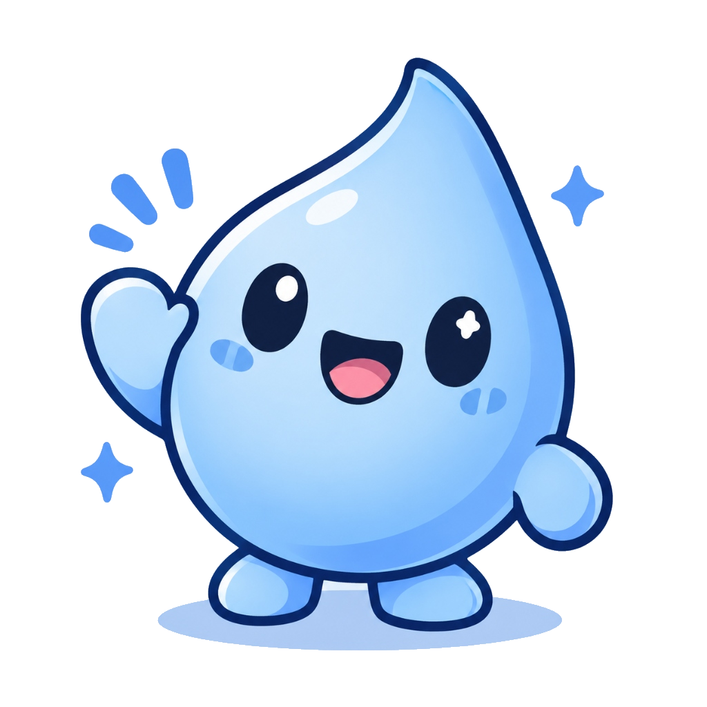

# 💧 Gotinha - Lembrete de Água Fofo & Zen

<div align="center">



<br>

**Um aplicativo desktop nativo para Windows (`.exe`), moderno, leve, acolhedor e com mascote animada para cuidar da sua hidratação e bem-estar.**

<br>

[](https://github.com/guedes-beatriz/app-pc)
[](https://github.com/guedes-beatriz/app-pc)
[](https://github.com/guedes-beatriz/app-pc)
[](https://github.com/guedes-beatriz/app-pc)
[](https://github.com/guedes-beatriz/app-pc)

</div>

---

## 📥 Como Baixar e Testar (Para Amigos)

Você não precisa instalar programas pesados nem ter conhecimentos técnicos para usar a Gotinha!

### Opção 1: Baixar o Pacote Portátil Pronto (Recomendado) 🚀
1. Baixe o arquivo zip direto aqui pelo GitHub: **[`dist/Gotinha-v2.0-Portable.zip`](dist/Gotinha-v2.0-Portable.zip)** (ou clique no botão verde **Code** ➔ **Download ZIP** no topo do repositório).
2. Extraia o arquivo zip em qualquer pasta do seu computador (como sua Área de Trabalho ou Documentos).
3. Dê **dois cliques em `Gotinha.exe`** e pronto! O app abrirá com uma animação fofa de boas-vindas.
4. 💡 **Dica de ouro:** Clique com o botão direito em `Gotinha.exe` ➔ *Enviar para* ➔ *Área de trabalho (criar atalho)* para abrir com 1 clique sempre que ligar o PC!

### Opção 2: Compilar do Código-Fonte 🛠️
Se você clonou o repositório e deseja compilar o executável sozinho:
- Dê um duplo clique em **`compilar.bat`**.
- O Windows usará o compilador nativo C# (`csc.exe`) e gerará o `Gotinha.exe` em menos de 2 segundos.

---

## ✨ Principais Recursos

### 💧 Mascote Interativa & Expressiva
- **Animações fluidas:** A Gotinha pisca, flutua suavemente e pula de alegria a cada gole registrado.
- **Frases de carinho:** Clique na Gotinha para receber lembretes motivacionais e carinhosos.
- **Celebração:** Ao atingir 100% da sua meta diária, a Gotinha ganha uma coroa de ouro e comemora com você!

### 🥛 Cards de Bebidas Vivos & Fofos
- Cores pastéis e badges individuais para identificação rápida:
  - ☕ **Gole:** +150 ml
  - 🥛 **Copo:** +250 ml *(com destaque e brilho sutil)*
  - 🥤 **Grande:** +350 ml
  - 🍶 **Garrafa:** +500 ml
  - ➕ **Personalizado:** digite qualquer quantidade em ml.
- **Clique tátil com efeito de mola:** Sensação gostosa e responsiva ao registrar água.
- **Pílula de Desfazer:** Registrou por engano? Desfaça com um clique ou com `Ctrl + Z`.

### ⏳ Temporizador Zen & Elegante
- Cápsula fluida com gradiente que se preenche com o passar do tempo.
- Pílulas táteis para ajustar o intervalo de lembrete com facilidade: **`15m`**, **`30m`**, **`45m`**, **`60m`**.
- Botão de pausa delicado para quando você for descansar ou estiver em reunião.

### 📊 Histórico & Gráfico Semanal
- **Abas em pílula segmentada:** Alterne com suavidade entre **Registros de Hoje** e **Gráfico 7 Dias**.
- **Cards de resumo:** Veja seu consumo total de hoje, sua média diária e quantos dias você bateu a meta nesta semana.
- **Gráfico de barras vivas:** Barras que crescem em ondas suaves, com medalhas de estrela nos dias em que você bateu a meta!

### 🌙 Modo Escuro (Oceano Noturno)
- Alterne entre o **Modo Claro (Brisa Aquática)** e o **Modo Escuro (Oceano Noturno)** com 1 clique no ícone de Sol/Lua ou pressionando `Ctrl + D`.
- Paleta noturna com azul marinho profundo (`#0F172A`) e ciano celestial (`#38BDF8`), calibrada para não cansar seus olhos à noite.

### 🔔 Lembretes & Bandeja do Sistema (Tray Icon)
- Lembretes visuais na tela com botões rápidos em formato de pílula.
- Notificações nativas integradas à Central de Ações do Windows.
- Sons relaxantes de gota e sino ao registrar água.
- Minimização para a bandeja (perto do relógio do Windows) para rodar silenciosamente em segundo plano sem atrapalhar seu trabalho.

### 🔒 100% Offline & Privado
- Não requer internet, cadastro ou login.
- Todos os registros ficam salvos localmente no seu computador em `dados_agua.json`.

---

## ⌨️ Atalhos Rápidos de Teclado

| Tecla | Ação |
|:---:|---|
| <kbd>Espaço</kbd> | Registra um Copo de água (+250 ml) rapidamente |
| <kbd>Ctrl</kbd> + <kbd>Z</kbd> | Desfaz o último registro de água |
| <kbd>Ctrl</kbd> + <kbd>D</kbd> | Alterna entre Modo Claro e Modo Escuro |
| <kbd>Ctrl</kbd> + <kbd>H</kbd> | Alterna entre a visualização da Gotinha e o Histórico |
| <kbd>Ctrl</kbd> + <kbd>P</kbd> | Pausa ou retoma o temporizador de lembretes |
| <kbd>Esc</kbd> | Minimiza a Gotinha para a bandeja do sistema |

---

## 📁 Estrutura do Projeto

A pasta do projeto foi organizada de maneira limpa e modular:

```text
Água/
│
├── Gotinha.exe             # 🚀 Aplicativo compilado pronto para rodar (Windows)
├── GotinhaApp.cs           # 💻 Código-fonte C# da aplicação principal (WPF)
├── SplashWindow.cs         # 🌟 Código-fonte da tela de abertura animada
├── compilar.bat            # ⚡ Script em lote para compilar o app em 1 segundo
├── mascote.png             # 🎨 Mascote Gotinha oficial em alta resolução
├── app.ico                 # 🖼️ Ícone oficial do aplicativo (.ico)
├── dados_agua.json         # 💾 Banco de dados local em formato JSON
├── README.md               # 📖 Documentação do projeto
├── .gitignore              # 🛡️ Regras de arquivos ignorados pelo Git
│
├── dist/                   # 📦 Pacotes para distribuição
│   ├── Gotinha-v2.0-Portable.zip  # Pacote portátil pronto para enviar aos amigos
│   └── LEIA-ME.txt                # Instruções rápidas de uso
│
├── web/                    # 🌐 Versão Web interativa do Gotinha
│   ├── index.html
│   ├── style.css
│   └── app.js
│
└── tools/                  # 🛠️ Ferramentas e scripts auxiliares
    └── image_tools/        # Scripts de tratamento e upscaling de imagens
```

---

## 🛠️ Tecnologias Utilizadas

- **Linguagem:** C# (.NET Framework 4.8 / compatível com C# 5)
- **Framework de UI:** Windows Presentation Foundation (WPF)
- **Renderização e Gráficos:** XAML, Geometry Paths, DropShadowEffects, RenderTransforms
- **Áudio:** Geração algorítmica de ondas sonoras senoidais via buffer PCM nativo (`System.IO.MemoryStream`)
- **Persistência:** `System.Web.Extensions` (`JavaScriptSerializer`)

---

## 💖 Feito com Carinho

Criado com muito carinho e cuidado por **Beatriz Guedes** para tornar o hábito de beber água mais leve, divertido e acolhedor! 💧✨
